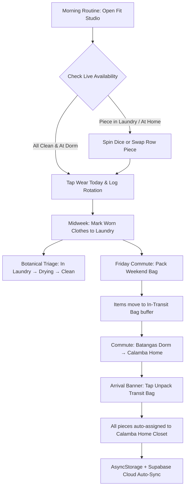

<p align="center">
  
</p>

<h1 align="center">DormDrobe — Smart Split-Wardrobe & Commuter Luggage Assistant</h1>

<p align="center">
  <strong>BatStateU Commuter & Dormer Life — Personal Capsule Wardrobe</strong><br/>
  A smart capsule wardrobe companion that eliminates split-closet confusion between dorm and home
</p>

<p align="center">
  
  
  
  
  
  
</p>

---

## About DormDrobe

DormDrobe is a smart split-location capsule wardrobe and commuter luggage assistant designed specifically for **Batangas State University (BatStateU)** dormers, commuters, and students who split their living spaces between **Batangas Dorm** and **Calamba Home**.

**For dormers & commuters:** Instantly track where every piece in your wardrobe lives (`Batangas Dorm`, `Calamba Home`, or `In-Transit Bag`), pack for the weekend in seconds with automated packing formulas, and unpack with a single arrival tap.

**For daily styling & capsule planners:** Spin the interactive multi-row Fit Studio mixer, record rotation history in the wear log, and bookmark curated looks with live availability badges (*"Ready at Dorm"* vs *"Piece in Laundry"*).

**For laundry & hygiene triage:** Follow a 5-step botanical cleanliness lifecycle (`Clean → Worn → In Laundry → Drying → Clean`) with optimistic local updates and instant Sonner-style undo toasts.

DormDrobe's core mechanism: the barrier to wardrobe tracking is effortless (1-tap condition cycle, zero-friction commuter luggage transfers) and the payoff is complete peace of mind—never forgetting a required uniform, favorite hoodie, or clean laundry behind again.

---

## Why DormDrobe?

- **Real-World Commuter Application:** Not a generic shopping or fashion app — purpose-built for the reality of dorm living, weekly university commutes, and split closets.
- **Commuter Luggage & 1-Tap Unpack:** Dedicated "In-Transit Bag" buffer with 1-tap arrival unpacking that auto-transfers transit garments to the current dormitory or home closet.
- **Tactile Botanical Lifecycle:** 5-state condition triage (`Clean`, `Worn`, `In Laundry`, `Drying`, `Misplaced`) with undoable batch actions.
- **Interactive Fit Studio & Live Lookbook:** Kinetic slot-machine style dice generator, multi-row outfit sliders, wear frequency logs, and real-time location/status validation.
- **Offline-First Resilience with Cloud Sync:** Operates 100% offline via AsyncStorage with optional cloud backup and real-time multi-device sync via Supabase PostgreSQL.

---

## Platforms Supported

### Mobile (Primary Platform)

- **Target:** Modern smartphones (iOS & Android via Expo Go and native EAS builds)
- **UI:** Phone-first tactile interface with fluid springs, liquid-glass frosted navigation tabs, and safe area insets
- **Camera:** Expo Image Picker for garment cataloging with client-side canvas background removal

### Web & Desktop Preview

- **Target:** Modern browsers (Chrome, Safari, Edge, Firefox)
- **Frame:** Built-in Apple-style mobile device simulator with responsive centering
- **Routes & Navigation Tabs:**
  - `/home` — Location switch, transit-bag banner (1-tap unpack), tappable Clean / Laundry / Bag counters, quick actions
  - `/closet` — Three zones (**Clean & Ready**, **Worn & Laundry**, **In Bag**), 1-tap Wear / To Laundry / Mark Clean on every card, and the **Pack Bag** checklist session
  - `/fitgen` — Multi-row Fit Studio, Dice outfit generator, Lookbook bookmarks, and Wear Log history
  - `/settings` — Profile, Supabase cloud sync status, custom campus locations, local storage reset
  - `/add` — Garment capture with camera/picker, color swatches, uniform flags, and local/AI background removal

---

## Core Features

### Home & Wardrobe Barometer

- **Real-Time Wardrobe Barometer:** Segmented breakdown of clean, worn, laundry, and drying garments
- **Location Distribution:** Visual indicator showing item counts across Batangas Dorm, Calamba Home, and In-Transit Bag
- **Luggage Unpack Banner:** Context-aware arrival card appearing whenever clothes are in transit, allowing 1-tap migration to the current location
- **Quick Action Hub:** Instant shortcuts to Pack Weekend Bag, Do Laundry, and Roll Daily Outfit
- **Recent Wear Feed:** Chronological rotation timeline tracking garment utilization and frequency

### Closet & Interactive Garment Sheet

- **Visual Wardrobe Catalog:** High-density responsive grid with category chips (Tops, Bottoms, Outerwear, Footwear, Underwear, Accessories)
- **Smart Filter Drawer:** Multi-facet filtering by location, condition state, uniform tags, and search keywords
- **Spring-Driven Bottom Sheet:** Tap any piece to inspect wear metrics, brand, and color swatches
- **1-Tap Condition Cycling:** Fast inline status progression (`Clean → Worn → In Laundry → Drying`)
- **1-Tap Location Switcher:** Reassign items between dorm and home with immediate feedback
- **Uniform White-Tee Flagging:** Special tag for university-mandated uniforms and required laboratory attire

### Commuter Luggage & Smart Packing Assistant

- **Dual-Mode Batch Operations:** Toggle effortlessly between **Laundry Triage** and **Commuter Packing**
- **Smart Packing Formulas:** 1-tap presets such as the **3-Day Weekend Formula** (3 Tops + 2 Bottoms + Underwear)
- **Selective Pack Filters:** Filter items by Clean, Dirty (carry-home laundry), or All
- **Transit Buffer Tracking:** Visual badge count on the In-Transit Bag prevents leaving garments behind
- **1-Tap Unpack on Arrival:** Automatically moves all in-transit pieces into your active closet upon arrival

### Fit Studio & Live Lookbook

- **Multi-Row Outfit Mixer:** Configurable 2-, 3-, or 4-row horizontal swiper (Tops, Bottoms, Footwear, Accessories)
- **Kinetic Dice Randomizer:** Roll the dice for instant randomized, color-coordinated outfit combinations
- **Live Availability Badges:** Real-time validation badges (*"Ready at Dorm"* vs *"Piece in Laundry"* vs *"At Home"*)
- **"Wear Today" Action:** 1-tap logs the outfit into Wear History, increments wear counters, and updates piece conditions to `worn`
- **Curated Lookbook:** Save favorite outfit formulas with custom names, tags (*Campus*, *Uniform*, *Rainy Day*), and date badges
- **Wear Log Timeline:** Detailed chronological ledger of past worn outfits by date and campus location

### Botanical Laundry Triage Machine

- **Optimistic State Machine:** Instant condition transitions without UI freeze
- **Complete Hygiene Cycle:** `Worn → In Laundry → Drying → Clean`
- **Sonner-Style Undo Toasts:** Floating interactive toast with instant "Undo" capability for accidental clicks
- **Batch Washing:** Send all dirty dorm clothes to laundry in a single batch tap

### Offline-First Architecture & Supabase Sync

- **Zero-Latency Offline Mode:** Full local persistence via `@react-native-async-storage/async-storage`
- **Optional Supabase Cloud Backup:** PostgreSQL database sync for multi-device access and cloud backups
- **Pre-Seeded Wardrobe:** 18 pre-configured realistic student garments across Batangas and Calamba for instant testing

---

## Wardrobe States & Commuter Taxonomy

### Garment Lifecycle & Condition States

| State | Color Tint | Status Meaning | Common Transition |
|---|---|---|---|
| **Clean** | `#16A34A` Laurel Green | Fresh, folded/hung, ready to wear | Mark as `worn` when wearing today |
| **Worn** | `#D97706` Golden Ochre | Worn once; wearable again or ready for laundry | Move to `in_laundry` or re-wear |
| **In Laundry** | `#EA580C` Persimmon Terracotta | In laundry hamper, washing machine, or laundry bag | Move to `drying` after washing |
| **Drying** | `#2563EB` Cobalt Air | Hanging on the dorm drying rack or clothesline | Cycle back to `clean` when dry |
| **Misplaced** | `#DC2626` Brick Crimson | Item temporarily unaccounted for | Recover to `clean` or mark found |

### Multi-Location Anchors & Commuter Flow

| Location | Brand Anchor | Primary Function | Workflow Trigger |
|---|---|---|---|
| **Batangas Dorm** | `#1D4ED8` Coastal Indigo | University residence closet & weekday study hub | Weekday class routine & dorm laundry |
| **Calamba Home** | `#B45309` Warm Terracotta | Home wardrobe, seasonal jackets, weekend rest | Weekend laundry & wardrobe restocking |
| **In-Transit Bag** | `#4D6B53` Commuter Sage | Duffel bag, backpack, or weekend commuter luggage | Commuting between Calamba and Batangas |

### Commuter Packing Presets & Formulas

| Formula | Target Days | Suggested Capsule Breakdown | Best For |
|---|:---:|---|---|
| **3-Day Weekend** | 3 Days (Fri–Sun) | 3 Tops + 2 Bottoms + 3 Underwear + 1 Footwear | Friday afternoon trip home to Calamba |
| **Uniform Essentials** | 5 Days (Mon–Fri) | 3 White Uniform Tees + 2 Campus Slacks + Lab Coat | Sunday return commute back to Batangas Dorm |
| **Laundry Run** | Any | All dirty/worn pieces moved to `in_transit_bag` | Bringing dorm laundry home for weekend wash |

---

## Technical Architecture

### Project Structure

```
dormdrobe/
├── assets/                       # Brand icons, splash screens, and SVG logo
│   ├── brand-dormdrobe.svg       # Official vector brand badge
│   ├── icon.png                  # App launcher icon
│   └── splash-icon.png           # Splash screen graphics
├── src/
│   ├── components/               # Tactile & architectural UI components
│   │   ├── AppIcons.tsx          # Lucide-based high-performance SVG icon registry
│   │   ├── ClothingCard.tsx      # Garment card with status ring and location indicator
│   │   ├── GarmentDetailSheet.tsx# Spring-driven bottom sheet with 1-tap state cycle
│   │   ├── LiquidGlassTabBar.tsx # Translucent frosted bottom navigation bar
│   │   ├── LiquidGlassLocationSwitch.tsx # Segmented campus location switcher
│   │   ├── ClosetFilterDrawer.tsx# Category and condition multi-selector drawer
│   │   ├── OutfitSwiperRow.tsx   # Kinetic horizontal outfit row slider
│   │   ├── OutfitTierSeparator.tsx# Clean visual dividers for Fit Studio layers
│   │   ├── PressableScale.tsx    # Haptic-like spring press interaction wrapper
│   │   ├── SonnerToast.tsx       # Floating interactive undo notification toast
│   │   ├── DeviceFrame.tsx       # Responsive mobile frame for web browser preview
│   │   └── UnpackPromptModal.tsx # Smart Unpack sheet (+ shared useUnpackFlow hook)
│   ├── config/
│   │   └── supabase.ts           # Supabase client initialization & auth setup
│   ├── context/
│   │   └── WardrobeContext.tsx   # Unified wardrobe state machine & persistence engine
│   ├── navigation/
│   │   └── TabNavigator.tsx      # Bottom tab navigator with custom glass tab bar
│   ├── screens/                  # Application screens
│   │   ├── HomeScreen.tsx        # Location switch, bag banner, status counters, quick actions
│   │   ├── ClosetScreen.tsx      # 3-zone closet, laundry actions, bag tab & Pack Bag session
│   │   ├── FitGeneratorScreen.tsx# Fit Studio, dice mixer, Lookbook, and Wear Log
│   │   ├── AddItemScreen.tsx     # Photo capture, swatch picker, and garment cataloging
│   │   └── SettingsScreen.tsx    # User profile, location preferences, Supabase sync
│   ├── theme/
│   │   └── theme.ts              # Warm Atelier Minimalist design tokens & typography
│   ├── types/
│   │   └── wardrobe.ts           # TypeScript interfaces, enums, and state models
│   └── utils/
│       ├── backgroundRemoval.ts  # Client-side canvas background removal utility
│       ├── mockData.ts           # 18 pre-seeded realistic student garments
│       └── storage.ts            # AsyncStorage serialization & migration wrappers
├── App.tsx                       # Root component, providers, and safe-area wrapper
├── app.json                      # Expo application manifest
├── supabase_schema.sql           # PostgreSQL schema, RLS policies, and Realtime triggers
└── package.json                  # Dependencies and execution scripts
```

### Technology Stack

| Layer | Technology |
|---|---|
| **Framework** | React Native 0.88, Expo SDK 58 |
| **Language** | TypeScript 6.0 |
| **State & Engine** | React Context + Custom Reducer State Machine |
| **Local Storage** | `@react-native-async-storage/async-storage` (Offline-First) |
| **Cloud Backend** | Supabase (PostgreSQL 15, Row-Level Security, Realtime) |
| **Navigation** | `@react-navigation/bottom-tabs` & `@react-navigation/native` v7 |
| **Media & Photos** | `expo-image-picker`, Canvas-based Background Removal |
| **Icons & Design** | `react-native-svg`, Custom SVG Icon Registry, Warm Atelier Tokens |

### Supabase Database Schema

```sql
-- 1. Clothing Items
/clothing_items
  ├── id (text, primary key)
  ├── name (text)
  ├── category (text check: tops, bottoms, underwear, footwear, outerwear, accessories)
  ├── color (text)
  ├── brand (text)
  ├── location (text check: calamba_home, batangas_dorm, in_transit_bag)
  ├── status (text check: clean, worn, in_laundry, drying, misplaced)
  ├── image_url (text)
  ├── is_uniform_white_tee (boolean)
  ├── last_worn_at (timestamptz)
  ├── notes (text)
  └── created_at (timestamptz)

-- 2. Lookbook Saved Outfits
/saved_outfits
  ├── id (text, primary key)
  ├── name (text)
  ├── top_id (text references clothing_items)
  ├── bottom_id (text references clothing_items)
  ├── shoes_id (text references clothing_items)
  ├── accessories_id (text references clothing_items)
  ├── tags (text[])
  └── created_at (timestamptz)

-- 3. Wear History Ledgers
/wear_history
  ├── id (text, primary key)
  ├── outfit_name (text)
  ├── item_ids (text[])
  ├── location (text check: calamba_home, batangas_dorm, in_transit_bag)
  └── worn_at (timestamptz)
```

---

## Installation & Setup

### Prerequisites

- **Node.js:** 18+ (20+ recommended)
- **npm:** 9+
- **Expo Go App:** Installed on your physical device ([iOS App Store](https://apps.apple.com/app/expo-go/id982107779) / [Google Play Store](https://play.google.com/store/apps/details?id=host.exp.exponent))
- **Git:** For cloning the repository

### Clone the Repository

```bash
git clone https://github.com/samuelordialeseya/DormDrobe.git
cd DormDrobe
npm install
```

### Setup Environment Variables (Optional)

DormDrobe runs out of the box in **100% Local-First / Zero-Knowledge mode** using AsyncStorage. To optionally sync your wardrobe to Supabase:

1. Copy `.env.example` to `.env`:
   ```bash
   cp .env.example .env
   ```
2. Populate your Supabase project credentials:
   ```env
   EXPO_PUBLIC_SUPABASE_URL=https://your-project.supabase.co
   EXPO_PUBLIC_SUPABASE_ANON_KEY=your-anon-key
   ```

### Setup Supabase Database (Optional)

1. Open your [Supabase Dashboard](https://supabase.com/dashboard).
2. Navigate to the **SQL Editor**.
3. Copy the contents of [`supabase_schema.sql`](supabase_schema.sql) and click **Run**.
4. Row Level Security (RLS) policies and Realtime tables will be provisioned automatically.

### Pre-Seeded Student Wardrobe

The application includes 18 realistic pre-seeded student garments (Uniform White Tees, Denim Jeans, Oversized Hoodies, Sneakers, Canvas Backpacks) distributed between Batangas Dorm and Calamba Home for immediate out-of-the-box testing.

---

## Running the App

### Development

```bash
# Start the Expo development server
npm start
```

Once the terminal server displays the QR code:
- **iOS:** Open the native **Camera** app and tap the Expo Go banner
- **Android:** Open the **Expo Go** app and scan the terminal QR code
- **Web Browser:** Press `w` in your terminal or run `npm run web`
- **Android Emulator:** Press `a` in your terminal
- **iOS Simulator:** Press `i` in your terminal

### Production Build

```bash
# Export static bundle
npx expo export

# Build standalone APK/AAB or IPA with EAS
npx eas build -p android --profile preview
npx eas build -p ios --profile preview
```

---

## App Flow



1. **Morning Routine:** The student opens `/fitgen` (Fit Studio) to roll or customize their outfit for the day.
2. **Availability Check:** Live badges confirm all pieces are physically present at the current location and in `clean` status.
3. **Wear Today:** Tapping "Wear Today" logs the combination to Wear History and transitions items to `worn`.
4. **Laundry:** In **Closet → Worn & Laundry**, tap **Worn → Laundry** and **Wash all → Clean** (or the 1-tap button on any card). The lifecycle is `Clean → Worn → In Laundry → Clean`, each step with an instant Undo toast.
5. **Friday Commute:** Tap **Pack Bag** (Home or Closet) to open the checklist session, tick what you're bringing (or tap **3-Day Weekend**), then **Put N items in Transit Bag**.
6. **Transit:** All packed garments reside safely in the `in_transit_bag` buffer, visible in **Closet → In Bag**.
7. **Arrival & Unpack:** Switch to where you arrived and tap **Unpack**. If the bag holds worn / laundry pieces you choose **Mark all clean**, **Send dirty ones to laundry**, or **Keep as they are**; an all-clean bag unpacks in a single tap.
8. **Cloud Sync:** State changes persist immediately to AsyncStorage and sync to Supabase in the background when connected.

---

## Feature Comparison

| Capability | Batangas Dorm | Calamba Home | In-Transit Bag | Laundry Triage | Lookbook Studio |
|---|:---:|:---:|:---:|:---:|:---:|
| Location-based browsing | Yes | Yes | Yes | — | — |
| Single-tap status cycling | Yes | Yes | — | Yes | — |
| Commuter luggage packing | Yes | Yes | Target | — | — |
| 1-Tap arrival unpack | Target | Target | Source | — | — |
| Multi-row outfit mixing | Yes | Yes | — | — | Yes |
| Kinetic dice randomizer | Yes | Yes | — | — | Yes |
| Wear history logging | Yes | Yes | — | — | Yes |
| Botanical laundry cycle | Yes | Yes | — | Yes | — |
| Interactive undo toast | Yes | Yes | Yes | Yes | Yes |
| Offline persistence | Yes | Yes | Yes | Yes | Yes |
| Supabase cloud sync | Yes | Yes | Yes | Yes | Yes |

---

## Why This Project Stands Out

### 1. Solves a Real Campus Commuter Problem

- Built specifically for the dual-closet reality of college dormers and commuters.
- Directly eliminates packing anxiety, redundant clothes purchases, and forgotten uniform dilemmas.
- Bridges the logistical gap between campus living and home rest.

### 2. Tactile, Kinetic Mobile Craft

- "Warm Atelier Minimalist" visual identity tailored with linen paper canvas and obsidian ink.
- Interactive multi-tier Fit Studio with physics-driven dice shaking and smooth horizontal snap swiping.
- Spring-driven bottom sheets with instantaneous single-tap condition cycling and zero lag.

### 3. Zero-Anxiety Luggage Lifecycle

- Introduces the dedicated `in_transit_bag` abstraction that acts as a safe buffer between physical locations.
- Commuter packing formulas remove decision fatigue on Friday afternoons.
- Context-aware arrival banner provides effortless 1-tap unpacking.

### 4. Production-Grade Offline-First Architecture

- Operates with zero cloud dependency out of the box via robust AsyncStorage serialization.
- Opt-in Supabase PostgreSQL backend with Row Level Security (RLS) and real-time multi-device updates.
- Optimistic updates backed by Sonner-style undo toasts ensure the interface never hangs.

---

## Development

### Build Commands

```bash
# Install dependencies
npm install

# Start Expo development server
npm start

# Run on Web (Browser)
npm run web

# Run on Android Emulator / Device
npm run android

# Run on iOS Simulator / Device
npm run ios

# Export static production bundle
npx expo export
```

### Key Components

| Component | Purpose |
|---|---|
| `HomeScreen.tsx` | Location switch, transit-bag banner, Clean / Laundry / Bag counters, quick actions |
| `ClosetScreen.tsx` | Three-zone closet, laundry batch actions, bag tab, and Pack Bag checklist session |
| `FitGeneratorScreen.tsx` | Multi-row Fit Studio, kinetic dice mixer, Lookbook, and Wear Log |
| `AddItemScreen.tsx` | Garment camera capture, swatch picker, and uniform categorization |
| `GarmentDetailSheet.tsx` | Spring bottom sheet with 1-tap condition cycle and location transfers |
| `LiquidGlassTabBar.tsx` | Frosted liquid-glass bottom navigation bar with tactile feedback |
| `WardrobeContext.tsx` | Unified state machine, optimistic updates, and persistence engine |
| `supabase.ts` | Supabase client configuration, table listeners, and sync hooks |

---

## Team & Context

Developed for **BatStateU Dormer & Commuter Life** to streamline personal capsule wardrobe management.

| Role | Contributor | GitHub |
|---|---|---|
| Full-Stack Architecture & Mobile Engineering | Samuel Ordiales | [@samuelordialeseya](https://github.com/samuelordialeseya) |

**Repository:** [github.com/samuelordialeseya/DormDrobe](https://github.com/samuelordialeseya/DormDrobe)

---

## License

This project is licensed under the MIT License — see the [LICENSE](LICENSE) file for details.

---

<p align="center">
  <strong>DormDrobe</strong><br/>
  Eliminating wardrobe anxiety and split-closet chaos for college commuters. 🧥
</p>
